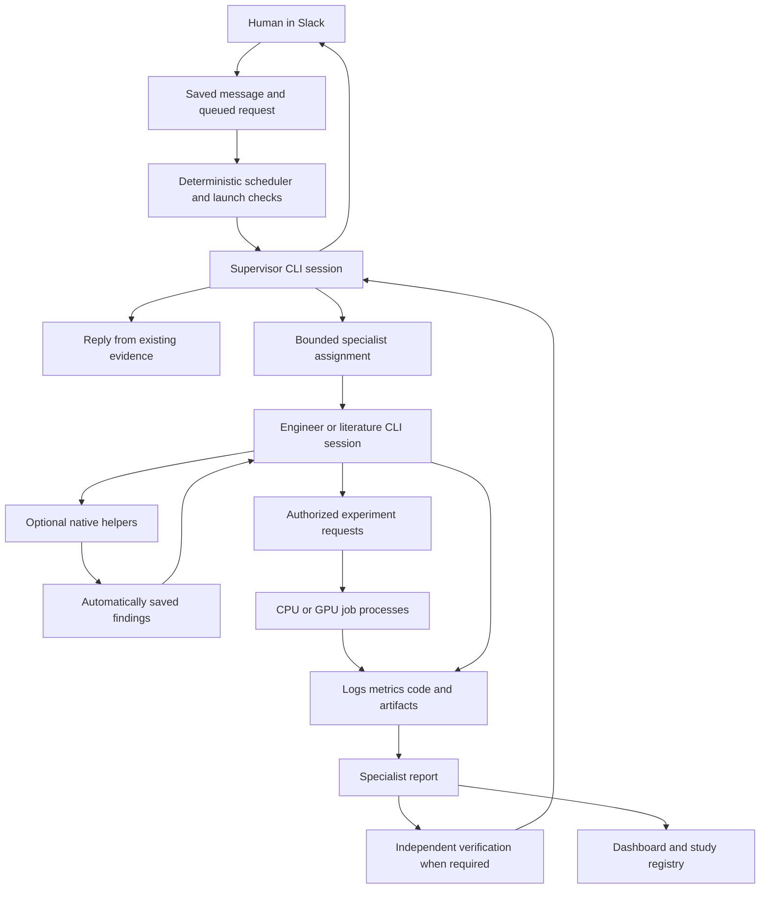

# Research Observatory

A self-hosted research workspace that connects Slack conversations, Claude Code agents, scheduled CPU/GPU experiments, a paper library, reports, and an interactive dashboard.

You talk to a supervisor in Slack. It can answer questions from existing evidence, assign bounded work to an engineer or literature specialist, request independent verification, and report back in the same discussion. A deterministic Python daemon handles queues, budgets, resources, persistence, and delivery. Models run when authorized work needs them; an idle scheduler does not call a model.

**Bring your own server, Claude access, and Slack application.** This repository contains reusable platform code and synthetic tests. It contains no deployed accounts, research records, Slack workspace, server credentials, or pre-existing project memory.

## Contents

- [Quick start](#quick-start)
- [What is included](#what-is-included)
- [A first research task](#a-first-research-task)
- [How work moves through the platform](#how-work-moves-through-the-platform)
- [The important concepts](#the-important-concepts)
- [Agents, context, and memory](#agents-context-and-memory)
- [Experiments and compute](#experiments-and-compute)
- [Reports, studies, and research notes](#reports-studies-and-research-notes)
- [Scheduling and configuration](#scheduling-and-configuration)
- [Records and files](#records-and-files)
- [Security and remote access](#security-and-remote-access)
- [Testing](#testing)
- [Operations and troubleshooting](#operations-and-troubleshooting)
- [Limitations](#limitations)
- [Development and license](#development-and-license)

## Quick start

### 1. Prepare a Linux host

Use Python 3.11+, Git, a current Claude Code CLI, and a Linux kernel with Landlock support. Linux is required for the filesystem and plotting sandboxes. NVIDIA GPUs are optional. This is intended for a trusted operator's server, not a shared public service for mutually untrusted customers.

Clone this repository using the URL shown on GitHub, then enter its directory. Start with the platform environment:

```bash
python3.11 -m venv .venv
source .venv/bin/activate
python -m pip install -r requirements.txt
cp config.example.yaml config.yaml
```

Edit `config.yaml`:

- Set `human_name` and `timezone` for your installation.
- Set `claude.python_env: null` when launching from this activated virtual environment. The example uses `claude-env` for operators who prefer Conda.
- Keep `claude.sandbox: true`.
- Adjust CPU, GPU, job, model-session, and helper capacities for your machine.
- In `slack.allowed_user_ids`, list the Slack users who may control the lab. An empty list permits users in the bot's joined channels to interact with it; it does not mean owner-only access.

For a research environment with the optional scientific/PyTorch stack, review `environment.yml` or `environment-linux.yml` before running `bash setup_env.sh`. The Linux variant installs GPU PyTorch and may be a large download. It is not required just to inspect the dashboard. Do not run the environment recreation option against an environment you need to preserve.

### 2. Install and authenticate Claude Code

Install the Claude Code CLI using its official installation instructions. Confirm `claude --version` works in the same terminal that will run the daemon. The default backend invokes Claude Code directly; no OpenAI backend or Codex review loop is included.

Log in under your own primary profile:

```bash
mkdir -p runtime/claude-auth/primary
CLAUDE_CONFIG_DIR="$PWD/runtime/claude-auth/primary" claude auth login
```

Use only accounts and access you are entitled to use, under the provider's current terms. This application does not grant subscription capacity or remove provider limits. Account credentials and CLI histories are local private runtime data.

Additional profiles are optional. Add an account with its own directory in `config.yaml`, then authenticate that directory separately:

```yaml
claude:
  accounts:
    - id: primary
      config_dir: runtime/claude-auth/primary
    - id: secondary
      config_dir: runtime/claude-auth/secondary
```

```bash
mkdir -p runtime/claude-auth/secondary
CLAUDE_CONFIG_DIR="$PWD/runtime/claude-auth/secondary" claude auth login
```

For each new platform session, the account selector uses available, sufficiently fresh model-relevant usage information and account status. A running session retains its account. Switching profiles does not merge subscriptions into one provider entitlement. The platform can preserve its own conversation continuity across profiles using saved CLI histories.

### 3. Create your own Slack app

1. Create a Slack app from `slack_app_manifest.yaml` in the workspace you control.
2. Enable Socket Mode. Create an app-level token with `connections:write`.
3. Install the app to your workspace. Obtain its bot token.
4. Copy the local environment template and fill the two values in your editor:

   ```bash
   cp .slack.env.example .slack.env
   chmod 600 .slack.env
   ```

5. Invite the app to a channel. That channel becomes a project workspace when enrolled.
6. Optionally upload `supervisor.png` as the Slack app icon. It is a generic platform asset.

Keep tokens out of terminal transcripts, screenshots, Git, prompts, research files, and Slack messages. Reinstalling the Slack app may be necessary after changing its scopes.

### 4. Build the editor and optional PDF tools

The static dashboard/editor assets are included. For Notes PDF exports and browser tests, install Node.js 20+ with npm, then run:

```bash
bash scripts/setup_frontend.sh
```

This installs pinned frontend dependencies, rebuilds the local editor, and puts Playwright Chromium under the ignored `runtime/` directory. Some hosts also need Chromium's Linux system libraries installed by their administrator. `--skip-browser` only builds the editor.

Native Claude CLI PDF page previews may additionally need Poppler's `pdftoppm`. Without it, text extraction can work while visual page inspection fails. Install it through your host's package manager if needed; the platform does not silently grant an agent permission to install system packages.

### 5. Check and start the services

```bash
python lab.py doctor
python lab.py doctor --slack
python lab.py init
python labd.py
```

`doctor --slack` performs a live Slack authentication check. `init` initializes local records; it does not invent a research project or run experiments. The daemon enrolls invited channels and processes authorized requests. An invitation may trigger one short onboarding response; it does not authorize a research program.

In a second terminal, activate the same Python environment and start the dashboard:

```bash
python lab.py dashboard
```

Open **http://127.0.0.1:8765**. To keep services running after disconnecting, use your process supervisor, `screen`, or `tmux`. See [operations](docs/operations.md) for lifecycle and backup guidance. The daemon lock prevents duplicate schedulers.

## What is included

| Component | Purpose |
| --- | --- |
| Slack supervisor | Research discussion, work planning, specialist assignments, result synthesis, and human communication |
| Engineer | Implements methods, prepares experiments, analyzes saved outputs, and creates evidence artifacts |
| Literature specialist | Retrieves/reads papers, distinguishes reading depth, creates structured paper notes, and prepares digests |
| Independent verifier | Checks a submitted result against its evidence, implementation, and stated acceptance conditions |
| Native CLI helpers | Bounded internal subtasks within engineer/literature assignments; complete findings are saved automatically |
| Experiment scheduler | Launches authorized CPU/GPU processes with resource accounting, time limits, logs, and metrics |
| Overview and Work | Account usage snapshots, CPU/GPU telemetry, sessions, assignments, blockers, dependencies, and progress |
| Conversations | Recorded human/supervisor discussions and supported specialist meeting records |
| Experiments | Queued/running/completed jobs, allocations, commands, metrics, and artifacts |
| Library | Paper notes, topic-organized research digests, reading depth, source links, and reports |
| Research Story | Study table with purpose, execution/documentation status, and current report PDF links |
| Research Notes | Human-owned rich notes with equations, tables, boxes, figures, formatting, revisions, and reviewed agent suggestions |
| Research Chat | Separate Claude discussion partner with workspace evidence, memory, figures, and bounded derivative plotting |

## A first research task

Send a scoped request in a channel joined by your bot. For example:

> Please compare two published approaches to a small synthetic regression problem. First propose a hypothesis, controls, metrics, and an experiment plan. Use CPU only and do not launch a sweep until we agree on the plan. Explain which sources were read in full.

Keep follow-ups about the same subject in the same Slack thread. A new top-level message starts a separate discussion. All discussions in a channel still share that project's durable records.

The supervisor can answer directly or create assignments. Ask for a small pilot before increasing compute. Check Overview/Work for the agent state and Experiments for the code-execution state. A queued assignment is waiting for an agent session; a queued experiment is waiting for a server process/resource allocation.

Useful deterministic Slack commands include `!status`, `!tasks`, `!jobs`, `!usage`, `!subscription`, and `!schedule`. “Pause this project” stops new dispatch for that project. “Resume this project” resumes eligible authorized work. “Close this thread” cancels unfinished assignments for the discussion; it is broader than cancelling one message. Pausing does not automatically terminate running experiments.

**Deleting a Slack message does not cancel an already saved request.** Message edits/deletions are not currently a reliable cancellation interface. There is no dedicated Cancel response button for Slack requests in this release. Research Chat has its own Stop control.

## How work moves through the platform



The daemon saves messages before dispatch, debounces related queued messages, and groups compatible requests. A session starts only when its project is active and its prerequisites, account status, budgets, concurrency, and other launch checks allow it.

A supervisor assignment specifies the role, scientific goal, acceptance conditions, model/effort, dependencies, time/session allowance, and authorized compute. A specialist may ask for clarification or a larger grant. It cannot silently raise its own grant or approve expensive jobs on the human's behalf.

The specialist submits a structured result and evidence paths. The platform validates actions, freezes submitted artifacts into project reports, updates durable records, and notifies the supervisor as appropriate. Verification is a separate assignment, not the author's helper agreeing with itself. The supervisor decides how to communicate and what to assign next within its authority.

Updating a dashboard study row, saving a note, or opening a view does not itself authorize experiments or a documentation rewrite. Routine idle polling is deterministic; explicitly scheduled wakes can authorize future model activity.

## The important concepts

| Term | Meaning |
| --- | --- |
| Project / workspace | Research context associated with a Slack channel: purpose, discussions, assignments, studies, library relevance, notes, and reports |
| Discussion / thread | Related Slack conversation; thread identity supports conversational continuity |
| Request | Saved event asking for a supervisor session, such as a human message or an authorized completion notification |
| Assignment / task | A durable work order with a goal, acceptance criteria, grants, dependencies, status, and evidence |
| Session | One bounded CLI execution for a supervisor or assignment; an assignment can require several sessions |
| Native helper | A subagent inside a specialist CLI session; it shares the assignment's resources/deadline and is not a separately scheduled specialist |
| Experiment / job | A scheduled OS process running research code; its lifetime and resource allocation are separate from the agent conversation |
| Report | A submitted result and frozen evidence artifacts; completion and scientific verification are distinct |
| Study | A scientific question or investigation linking assignments, experiments, conclusions, limitations, and report PDFs |
| Paper / digest | Versioned shared source notes plus project relevance, or a topic-organized reading synthesis |
| Research note | A human-owned document with independent revisions, suggestions, permissions, and figures |

A study is not an assignment and an assignment is not a GPU job. One study can have several assignments, and one engineer assignment can launch several jobs within its grant. Registering a study does not automatically run them.

Typical states:

| Label | Interpretation |
| --- | --- |
| Queued assignment | Eligible work is waiting for a model session or a launch gate; inspect its recorded hold reason |
| Running session | A CLI process is currently performing agent work |
| Waiting jobs | The specialist handed back while its scheduled code processes are running or queued |
| Awaiting review | A result was submitted and is waiting for supervisor acceptance/review; it does not imply the supervisor is currently running |
| Needs resources | The task needs an authorized increase or another resource condition resolved |
| Blocked / partial | The session explained missing evidence, an unresolved question, an error, or incomplete work |
| Deferred | Work has an explicit future eligibility time |
| Accepted | The submitted work was accepted; inspect the independent verification record for scientific verification |
| Cancelled | Work was withdrawn; completed artifacts/history are not automatically erased |
| Queued job | Code execution is waiting for compute or approval, not for a CLI to “wake up” |
| Done / failed job | The process exited successfully or unsuccessfully; success alone is not scientific validation |

The dashboard includes help for its views. Details and actual hold records take precedence over guessing from a color or reaction. Slack 👀 indicates a queued request; 🤔 indicates a running supervisor session associated with it. Reaction delivery can lag.

## Agents, context, and memory

The scheduler permits at most one active supervisor and one active head of each specialist role across the installation, in addition to any supported legacy managed workers. These are execution roles, not four permanently running personalities. Multiple projects queue work for these shared roles while keeping project context separate.

Each wake starts a CLI process. Saved CLI histories can restore the relevant supervisor thread or specialist assignment when configured and available. Specialists do not automatically receive the entire history of every assignment. Durable reports, checkpoints, code, project notes, and library records allow continuity across processes. Relevant evidence is supplied by the platform or explicitly read by the agent.

Engineer/literature heads can use native helpers when enabled. The helper limit is per specialist and separate from `scheduling.max_sessions`. Helper model/effort cannot exceed the assignment grant; configured defaults may be lower. Documentation work disables helper delegation under the current documentation policy.

Helpers return complete findings as text. The platform saves the exact final response to:

```text
helpers/native-results/<agent-id>/findings.md
helpers/native-results/<agent-id>/responses/<content-hash>.md
helpers/native-results/index.json
```

The index and normal tool-result notices expose the saved paths to the specialist. Distinct resumed responses are retained; duplicate/empty stop events do not erase a prior report. This does not add a model call. Code/tests/paper-note JSON files remain valid assigned helper deliverables when its tool set permits writing. Read-only researchers do not have Bash or Write tools. A helper review is internal feedback, not independent scientific verification.

Project CLI auto-memory, application checkpoints, conversation history, and Research Chat memory are different stores. Account selection changes authentication, not the project identity. Research Chat conversations/memory belong to the selected project and remain separate from the Slack supervisor.

## Experiments and compute

An engineer requests a job from its authorized workspace, for example:

```bash
python "$LAB_ROOT/lab.py" job start \
  --name "Synthetic CPU pilot" --hours 0.25 --gpus 0 --cpu-threads 2 \
  --seed 1 --config-file config.json --metrics metrics.json \
  -- python experiment.py
```

The runtime validates the request against its root assignment and server resources, writes a receipt, and starts the process when eligible. This command is for an agent's authorized workspace, not an unrestricted operator-side job submission API. All experiments, including pilots, use this route. Agents do not stay awake polling jobs.

GPU jobs support exclusive admission and optional sharing. Sharing reserves declared memory per job and limits jobs per GPU while leaving configured headroom; it is not a hard CUDA memory cap or a guaranteed fraction of compute. Benchmark shared throughput and record the mode. Exclusive admission excludes active/unmanaged GPU use according to the configured free-memory/utilization thresholds. See [GPU sharing](docs/gpu-sharing.md).

CPU thread caps and free capacity are accounted separately. Model session minutes, experiment hours, output-token reports, and provider subscription percentages are different quantities. Increasing a job count alone cannot guarantee higher utilization.

Jobs have wall-time limits and should save checkpoints incrementally. A timed-out job receives a termination signal and a grace period before forced shutdown. CUDA initialization must be checked explicitly; a silent CPU fallback is not successful GPU execution.

The shared base Python/Conda environment is read-only to sandboxed agents. Bash-capable agents can install dependencies inside their own writable assignment directory and must record how to reproduce that environment. GPU drivers, OS packages, and shared base-environment changes remain operator responsibilities.

## Reports, studies, and research notes

### Research Story

Research Story is a fixed study index, not an automatically rewritten living-paper webpage. The supervisor supplies the row's brief purpose and updates status/report links. In the paired-report configuration, each study can link:

- A **paper-section PDF**: a standalone scientific explanation of method, experiment, results, interpretation, and limitations.
- A **detailed-report PDF**: implementation/configuration, source evidence, reproduction instructions, and technical detail.

The registry also supports a single-report-with-appendix configuration. Pick one deliberately in `documentation.report_format` and keep its guidance consistent. The example preserves the paired-report workflow. Missing documents stay visibly missing; link availability is a mechanical check, not a verified result. Accepted PDFs should be reused unless a substantive change requires revision. See [study workflow](docs/studies/workflow.md).

### Library and digests

Paper notes record canonical source identity, title/authors/year/venue, read depth, methods, results, source sections, limitations, and project relevance. Shared paper versions and project relevance links are separate. A source summary does not establish a full read or verification of code/results. Research digests group papers by requested topic, with brief summaries and expandable details. See [digests](docs/research-digests.md).

### Human-owned Research Notes

Research Notes supports multiple named documents per project, H1/H2/H3, bold/italic/underline, font sizes, lists, equations, boxes, tables, figures, aligned content, and adjustable two-column blocks. It has reading preview, compact full-screen controls, Markdown copying by document/heading section, and saved-revision PDF export.

Saving a note does not wake the supervisor. Ask it in Slack to read a specific note/section or use Research Chat for discussion. Agents submit suggestions that remain pending until you accept them. A one-time human grant can authorize one supervisor edit in a chosen scope; creating the grant does not itself apply a suggestion or wake a model.

An older suggestion can be accepted only if its target source still matches exactly, with a current-revision concurrency check. An edit elsewhere need not invalidate it. Changed target sections remain blocked. Archiving a nonempty note retains its content/history and removes it from active agent evidence; truly empty note deletion uses a tombstone to prevent stale clients recreating it. See [Notes](docs/research-notes.md).

### Research Chat

The dashboard chat tab and floating panel share project-scoped conversations. Select account, model, and effort; chat memory is visible/editable. The chat can search workspace papers/summaries, read reports/PDF pages, view/retrieve figures, and propose reviewed note edits.

Its bounded Python plotting tool creates derivative figures/tables from staged inputs, retaining original evidence and provenance. It cannot launch experiment sweeps or change original research files. It is a separate discussion partner, not the Slack supervisor. It currently has no WebFetch/WebSearch tools; the supervisor and specialists do have those tools.

A new CLI process handles each chat turn and restores that conversation's saved CLI history when available. Stop preserves an interrupted partial reply; deleting a chat does not delete research evidence. Opening the bubble does not start inference. See [Research Chat](docs/research-chat.md).

## Scheduling and configuration

`config.example.yaml` is the public template; your `config.yaml` is ignored by Git. Defaults are starting points, not a promise of compatibility with every hardware size or subscription.

| Section | Controls |
| --- | --- |
| `claude` | CLI binary, Python environment, accounts, supervisor model/effort, history/memory, retries, turns, sandbox |
| `native_subagents` | Helper availability, concurrency, and default model |
| `scheduling` | Poll/debounce, platform-session slots, supervisor reservation, preemption, retries, session duration, safety ceilings |
| `subscription` | Provider metadata freshness, polling behavior, launch thresholds, and configured supervisor fallback |
| `budgets` | Global/project agent minutes, aggregate assignment grants, optional recorded output-token accounting, expensive-job threshold, job limits |
| `resources` | GPU eligibility/sharing, memory headroom, CPU capacity/reservations |
| `server_status` | Cached hardware telemetry |
| `slack` | Bot metadata, channel discovery, controlling user allowlist, urgent broadcasts |
| `research_story`, `documentation` | Registry presentation, report format, documentation workflow and model ceilings |
| `research_chat` | Chat availability, default model/effort, per-reply session duration |

The scheduler checks provider holds, role/session concurrency, pause state, dependencies, budgets, documentation focus, and resource capacity. It records the reason work cannot launch. `max_sessions` does not count native helpers as separate platform sessions. `max_workers` refers to legacy managed workers, not native helpers. A native helper has no separate platform lifetime invocation quota.

Actual provider quota/renewal still applies. Usage snapshots include activity outside this installation; stale or missing metadata is not treated as reliable free capacity. Page refresh reloads saved data. “Refresh account usage” requests a provider metadata check rather than a model wake. Operator commands include:

```bash
python lab.py subscription --refresh
python lab.py status
python lab.py schedule
```

Turn/session/job limits and grant values should be understood before raising them. Per-task output-token allowances from older versions are not current hard task-stop limits; recorded output usage and an optional daily accounting setting remain distinct from provider quota. Native helper token usage may be included in provider aggregates; the parser avoids counting forwarded helper events twice. See [architecture and records](docs/architecture.md) for the implementation details.

## Records and files

```text
config.example.yaml            Public configuration template
config.yaml                    Your ignored local configuration
.slack.env                     Your ignored Slack tokens
labd.py                        Daemon / Slack Socket Mode entry point
lab.py                         Operator and authorized-workspace commands
labcore/                       Scheduler, storage, tools, policies and dashboard server
prompts/                       Supervisor/specialist/helper/research/report instructions
frontend/research-notes/        Rich editor and chat source + dependency lockfile
labcore/dashboard/             Static dashboard and bundled local editor assets
runtime/lab.sqlite3            Private application database
runtime/sessions/              Private CLI execution logs
runtime/claude-auth/            Private account authentication/CLI state
runtime/claude-history/         Private application CLI history archives
runtime/claude-shared/          Private shared project CLI memory/plugins
runtime/research-chat*/         Private chat logs, assets and plotting scratch
runtime/dashboard-access/      Private optional remote-access login/settings
workspaces/<project>/<task>/    Assignment code, checkpoints, helper reports, controls
projects/<project-folder>/     Project notes, decisions, experiments, runs, frozen reports
library/papers/                Shared paper-note projections
```

The SQLite database uses `records(kind,id,data)` with JSON record payloads, an append-only event table, and transactional updates. Its data is not committed to Git. Record kinds include projects/channels/messages/requests, tasks/sessions/jobs, reports/decisions, paper versions/relevance links, digests, studies/document packages, Research Notes revisions/proposals/grants/assets, Research Chat messages/memory/assets, wakeups, settings, and the Slack outbox.

Records reference files; a database-only backup is not a complete research backup. Logs may contain source text, conversations, and provider/CLI metadata. Treat the entire runtime as private even if an individual file looks harmless. Full field/lifecycle explanations are in [architecture](docs/architecture.md).

## Security and remote access

The dashboard binds to loopback and enforces host/origin checks. Local research views are not a multi-user authentication boundary. Mutating note/chat routes require the dashboard's owner credentials. For local-only editing, create a private login file:

```bash
python - <<'PY'
import getpass, json, os
from pathlib import Path
folder = Path('runtime/dashboard-access')
folder.mkdir(parents=True, exist_ok=True, mode=0o700)
path = folder / 'credentials.json'
if path.exists():
    raise SystemExit('Credentials already exist; not overwritten.')
password = getpass.getpass('Choose a dashboard password: ')
if len(password) < 16:
    raise SystemExit('Use at least 16 characters.')
fd = os.open(path, os.O_WRONLY | os.O_CREAT | os.O_EXCL, 0o600)
with os.fdopen(fd, 'w') as stream:
    json.dump({'username': 'researcher', 'password': password}, stream)
PY
```

The browser can authenticate when an editing/chat endpoint challenges it. Use HTTPS when credentials cross a network. For remote use, prefer an SSH tunnel or a private network; the optional `dashboard_access.py` supports a user-owned Tailscale/Caddy proxy after installing those tools yourself. **Never publish the raw dashboard port directly.** See [remote access](docs/remote-dashboard.md).

Filesystem permissions and Landlock constrain sessions to project/source reads and their assigned writes. Read permission never implies write permission. GPU processes get a narrow process-local procfs exception needed by NVIDIA thread naming. Plotting adds seccomp restrictions that deny network/process spawning. These controls are defense in depth, not a container, full network isolation, protection from all prompt injection, or isolation between mutually hostile customers.

The account refresh tokens must be readable by the authenticated CLI and are inherently sensitive. Standard session logs are private. Use a dedicated server account and protect host backups. Do not place confidential credentials in papers, notes, reports, or agent-readable project files.

## Testing

The default tests use temporary stores/workspaces and fake Claude/Slack implementations. They do not require real model calls, Slack tokens, experiments, or a live project:

```bash
python -m unittest discover -s tests -q
node --test tests/notes_*.test.mjs tests/dashboard_digests.test.js
python scripts/check_public_release.py
```

Frontend unit tests require `npm ci` first. Real-browser tests run only when the local Node/Chromium tooling exists; run `scripts/setup_frontend.sh` to enable them. Some Linux tests exercise real process/filesystem sandboxing, so restrictive CI/container environments may need an appropriate runner rather than disabling safety checks.

Files named `tests/live_*.py` are explicitly opt-in live checks and can consume your provider allowance. They are not part of normal test discovery. Read each before running. Do not point tests at a live research database.

## Operations and troubleshooting

- **Nothing launches:** inspect the saved `launch_hold`, project pause state, dependencies, account renewal/quota, current role occupancy and budget reservation. A queued label does not identify the cause by itself.
- **Login renewal:** run `claude auth login` with the exact account's `CLAUDE_CONFIG_DIR`; a credentials file alone does not establish a usable login.
- **Gray usage bars:** check metadata status/freshness; gray is not proof of sign-out or zero remaining quota.
- **Dashboard won't load:** test `curl --max-time 5 http://127.0.0.1:8765/` on the server, then check the dashboard process and your tunnel/proxy. A reachable static page does not prove the API can read valid records.
- **PDF preview fails:** check Poppler for the CLI, Python PDF dependencies for evidence tools, and Node/Playwright plus Chromium system libraries for Notes exports. These are different paths.
- **Helper findings file missing:** inspect `helpers/native-results/index.json`, the helper's `report_error`, its completion status and the private transcript. A process killed before completion may not produce a final report.
- **Filesystem denied:** use the current workspace and `$TMPDIR`; global `/tmp`, another assignment, and the shared base environment are not writable.
- **GPU memory occupied but low utilization:** inspect process ownership, job declarations, memory allocation and actual throughput. Memory use is not compute utilization.
- **Slack text/table missing:** the transport supports rich text/table blocks and allowed attachments, but malformed or unsupported payloads need inspection. Do not treat missing text as approval to infer its content.

See [operations](docs/operations.md) for clean shutdown, restart behavior, backups, account setup and recovery. Do not delete runtime state to clear a queue or quota problem.

## Limitations

- Linux-specific process and filesystem security; the default sandbox intentionally fails closed when unsupported.
- Claude Code's tool/schema/hook behavior can change with CLI versions. Test a CLI upgrade with isolated checks before using it for research.
- Provider usage metadata is approximate, account-wide, and sometimes unavailable. No unlimited capacity is implied.
- Static link/PDF/file checks do not prove scientific correctness. Require original evidence and independent verification.
- Slack message deletion does not withdraw queued/running work. Some Slack socket errors require operator diagnosis.
- Optional remote HPC access is not an implemented multi-cluster batch scheduler. There are no bundled SSH keys or external server accounts.
- No automatic Codex/ChatGPT editorial loop or public shared-user chat system. Research Chat uses Claude only and has a narrower tool set than specialists.
- No automatic agent environment provisioning or permission to mutate the shared Conda installation.
- No automatic redo of completed work, private-record migration, or conversion of historical research into verified conclusions on install.

## Development and license

Python modules are intentionally small and mostly standard-library based. The frontend uses Tiptap, KaTeX, Markdown-It and Playwright/esbuild, with versions pinned in `frontend/research-notes/package-lock.json`. Run tests after changing scheduling, permissions, parsing, or artifact handling. Changes to Python services need a controlled restart; rebuilt static assets need a browser refresh.

The platform is MIT licensed; third-party components retain their own licenses. See [third-party notices](third_party/README.md). Never commit your installation's credentials or research: `config.yaml`, `.slack.env`, `runtime/`, `workspaces/`, `projects/`, and `library/` are intentionally ignored. Before publishing changes, run the public-release check and inspect `git diff --cached` and `git ls-files`.
