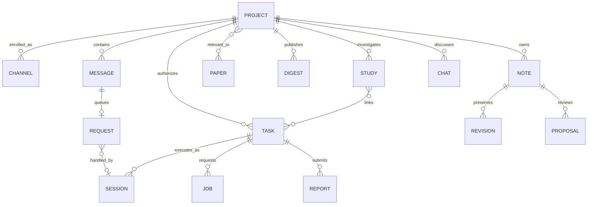

# Architecture, records, and execution model

This document describes the code in this release. The [README](../README.md) is the installation and user guide; this is the implementation map for operators and contributors.

## Processes and authority

`labd.py` holds a filesystem lock, initializes the engine/runtime, connects Slack Socket Mode, and ticks the deterministic scheduler. `labcore/slack.py` handles incoming messages, attachments, deterministic commands, approval actions and outgoing delivery. A bot invitation enrolls a channel/project and can queue a short onboarding response.

`labcore/engine.py` owns work orders, accepted structured actions, project context, report freezing and result application. `labcore/runtime.py` owns dispatch, gates, retries, preemption, scheduled wakes, job control ingestion and reconciliation. Its idle ticks do not invoke a model.

`labcore/runner.py` prepares environment/context/history/tools, starts sandboxed CLI processes, collects JSONL output and usage, and handles session termination/retry. `labcore/jobs.py` and the job-execution wrapper handle research processes separately. `labcore/dashboard.py` serves loopback HTTP, selected read views, and scoped authenticated Notes/Chat operations. It can run independently of the scheduler.

Models propose decisions through a structured result schema. They do not get a general database-write interface. The engine validates action scope and grants before applying those actions. A write in a model's workspace is not automatically a published paper record or an accepted scientific conclusion.

## Object relationships



This is a conceptual diagram. SQLite uses generic JSON records rather than one relational table per diagram entity; references and ownership are enforced in application code. For example, note proposal acceptance must resolve the current note/project, check the pending proposal, check source equality and revision concurrency, then commit atomically.

### Project and channel

A project stores name, purpose, status, folder, brief, daily allowance and other durable context. A channel stores Slack identity, active status and its project reference. Projects can have linked read-only evidence contexts, but ordinary assignments cannot write another project's records or workspaces.

Different projects have separate notes, discussions, studies and chat memory. The main scheduler's role concurrency is shared across the installation; creating a channel does not create permanently resident copies of every agent.

### Message and request

A message is the saved human input with Slack channel/thread/timestamp, user, text and creation metadata. A request is the queued trigger: reason, priority, project/thread, payload, status, and eventually its session ID. Requests also arise from explicit scheduled wakes and authorized completion notifications.

Message ingestion is deduplicated by channel/timestamp. Closely spaced compatible requests can be debounced/grouped for one supervisor session. A reaction is a transport-visible approximation of the saved request/session state. Slack edit/delete events do not currently implement cancellation, so deleting a Slack message does not delete this saved request.

### Task / assignment

A task is a work order, not an OS process. It records role, goal, acceptance, model/effort, dependencies, root/parent relationship, budget/resource grants, priority, attempts, status, follow-up authorization and related evidence/study/documentation context. Specialists may continue a task through multiple bounded sessions.

The root task's aggregate budget/resources also constrain its delegated work and experiments. A specialist cannot raise its own root grant. The supervisor can issue valid grant/clarification/reprioritization actions within current configuration and human approval boundaries. Compatibility records for legacy managed workers remain supported; native helpers are a different mechanism.

### Session

A session records one CLI invocation: task or request IDs, role/model/effort/account, allowed minutes, workspace, process identity, logs, timestamps, status, history parent/resume data, usage and whether its result was applied. Process identity checks reduce the chance of terminating or adopting an unrelated reused PID.

Supervisor sessions use discussion-scoped continuity; specialist sessions use assignment-scoped continuity. A resumed CLI history is evidence of conversational continuation, not shared consciousness. Checkpoints and artifacts remain important because histories can be absent, compacted, intentionally disabled for documentation, or interrupted.

### Job

A job records an experiment command and working directory, requested hours, CPU/GPU mode and reservations, metrics/config/seed paths, task/root ownership, status, approval, process identity and timing. The agent writes a control request; the scheduler validates it and creates a receipt. A queued job may be waiting for approval, job-count allowance, CPU capacity, eligible GPU memory/occupancy or a paused project.

Running jobs need not keep an agent CLI alive. `waiting_jobs` is the intentional handoff for asynchronous compute. Completion only queues further agent work when the relevant follow-up is authorized, otherwise the supervisor is notified that analysis needs authorization.

### Report and evidence

A submitted specialist result includes summary/findings/limitations/next steps and individual evidence paths. The platform freezes allowed files into the project's report artifact tree and stores the structured result/report record. This makes later tasks reference an immutable submitted snapshot instead of silently changing an earlier conclusion when workspace code changes.

A successful process, an author report, an available PDF, a helper review, and an independent passing verifier are different evidence levels. The supervisor's acceptance/review state and the verifier's scientific verdict should be inspected separately.

### Study and document packages

A study connects a scientific question with execution state, verification state, report links, task IDs, technical/source records, gaps and status explanation. Deterministic inspection checks referenced files and some PDF/readiness properties; it does not reproduce the science.

The Research Story table is generated from these records. Its standard layout is not an invitation for an agent to rewrite a growing narrative. Updating study metadata does not launch research or regenerate all PDFs. Documentation focus serializes the selected study/report phase and uses ordinary configured session grants. Paired report versus single-with-appendix configuration must match the installation's report-workflow guidance.

### Papers and digests

Papers use canonical IDs and versioned source-note records; project relevance is recorded separately. Notes distinguish abstract/partial/full reading and explicit source sections. Digests preserve structured topic/section/paper metadata plus readable summaries and evidence links. Library views can therefore group results by requested topic instead of forcing the human to inspect raw background tasks.

### Notes, proposals, permissions and archives

A project can have multiple human-owned notes. Each has a stable ID/title, current Markdown revision, figures, proposals and one-time grants. Revisions retain earlier saved source. Markdown layout extensions encode restricted formatting; arbitrary HTML/LaTeX execution is not enabled.

Agents propose comment/replace/append actions against a specific note and base revision. Original target source is stored with a proposal. Human acceptance permits an older proposal only while that exact target remains unchanged; it rechecks current expected revision atomically and preserves unrelated sections. Renamed/removed/changed targets stay blocked. One-time grants remain current-revision, scope-specific permissions for a supervisor edit and are not themselves model wakeups.

Unsaved browser drafts are separate from saved server source. Conflict detection preserves a newer local draft rather than silently replacing it after a concurrent server write. Agent reads refer to saved projections unless a user explicitly supplies a draft to Research Chat.

Archiving a nonempty note preserves saved content, revisions, figures and pending proposals while removing it from active evidence and revoking active grants. Empty-note deletion retains an identity tombstone. These operations do not create model work.

### Research Chat

Chat stores conversation records, messages, per-project memory revisions and derivative assets. Each turn starts one constrained Claude CLI process with saved conversation restoration. It uses workspace-scoped MCP evidence tools rather than the supervisor's general Bash/WebFetch/assignment capabilities.

The plotting subprocess stages authorized inputs, records hashes, permits only bounded derivative output, and uses Landlock/seccomp plus time/memory/disk limits. It cannot edit original evidence, use GPUs, make network calls or start other processes. Larger computations belong to engineer assignments. Chat deletion removes discussion records, not shared research evidence; provider CLI histories can have their own retention.

## Record storage

`labcore/store.py` creates:

```sql
CREATE TABLE records (
  kind TEXT,
  id TEXT,
  data TEXT NOT NULL,
  PRIMARY KEY (kind, id)
);
CREATE TABLE events (
  id INTEGER PRIMARY KEY,
  time TEXT,
  action TEXT,
  data TEXT
);
```

Connections use WAL and transactional writes. The records table contains JSON snapshots; events record significant transitions. Do not manually edit one JSON field to bypass a grant or repair a live lifecycle. Use supported controls or a deliberate offline repair with a backup and validation.

| Record group | Typical kinds |
| --- | --- |
| Routing and authority | `projects`, `channels`, `messages`, `requests`, `commands`, `closed_threads` |
| Work and execution | `tasks`, `sessions`, `jobs`, `reports`, `meetings`, `decisions` |
| Reading | `papers`, `paper_versions`, `paper_links`, `digests`, `digest_versions` |
| Study/documentation | `studies`, `document_packages`, `documentation_focus` and associated publication state |
| Human notes | `research_notes`, `research_note_revisions`, `research_note_proposals`, `research_note_grants`, `research_note_assets`, note archive/tombstone metadata |
| Discussion partner | `research_chats`, `research_chat_messages`, `research_chat_memory`, `research_chat_assets` |
| Operation | `settings`, `wakeups`, `outbox` and delivery/activity metadata |

Some state also lives in private control/JSON files for subprocess handoff, auth refresh, telemetry and CLI history. A native helper's `control/native-state.json` is operational metadata; complete auto-saved findings live under the publishable workspace `helpers/native-results/` tree. Do not expose control/auth files as research artifacts.

## Launch gates and resources

Dispatch checks overall slots, role concurrency, supervisor reservation, project/channel activity, thread closure, dependencies, root cancellation, assignment/session grants, quota/auth holds, documentation focus and daily time reservation. Jobs additionally need server compute and any human approval above the configured cost threshold.

| Quantity | Interpretation |
| --- | --- |
| Global/project daily agent minutes | Model-session wall time/reservations across the applicable work, not GPU hours |
| Assignment minutes/sessions | Aggregate authorized agent execution over task continuations and applicable delegation |
| Platform `max_sessions` | Supervisor/specialist/legacy managed worker CLI process capacity |
| Native helper concurrency | Parallel helpers inside each eligible specialist CLI; separate from platform slots |
| Job hours | Allowed lifetime/cost estimate of a research code process |
| GPU memory reservation | Admission estimate for shared jobs; not driver-enforced memory isolation |
| CPU threads | Job/assignment caps plus server headroom and observed capacity |
| Output tokens | Recorded provider/model usage, subject to configured accounting; not the provider's subscription allowance |
| Provider utilization | Account-wide rolling limits, potentially including activity elsewhere |

Known provider reset times guide waits. Unknown resets use a conservative fallback. Retries are bounded; errors and holds should be recorded rather than causing unlimited model wakeups. Idle provider polling can be disabled independently of manual refreshes.

## Trust boundaries

- Slack ingress accepts messages only from allowed users/channels, but content from papers, attachments and chats is still untrusted input to a model.
- Role tools, structured action validation, grant checks, path scoping and immutable evidence snapshots constrain authority.
- Landlock read grants never imply write grants; sessions write only their workspace/private required CLI state and designated scratch areas.
- The CLI must handle its authentication, so its accessible credentials are sensitive. Landlock is not a network sandbox, full container or complete secret-exfiltration defense.
- Dashboard loopback/host/origin checks and owner auth protect the intended access path; there are no independent viewer roles or public multi-tenant authorization model.
- Notes plotting uses additional process/network denial, but research jobs intentionally run research code under their assigned resource/filesystem boundaries.
- Default file/record checks establish mechanical consistency, not the truth of a research claim.

See [security](../SECURITY.md) and [operations](operations.md) before deploying remotely or backing up state.
